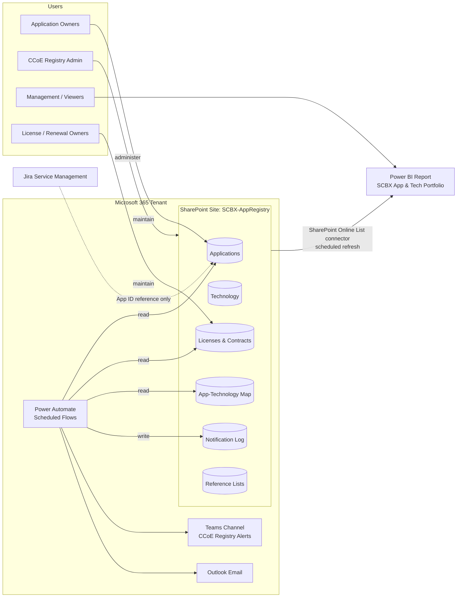
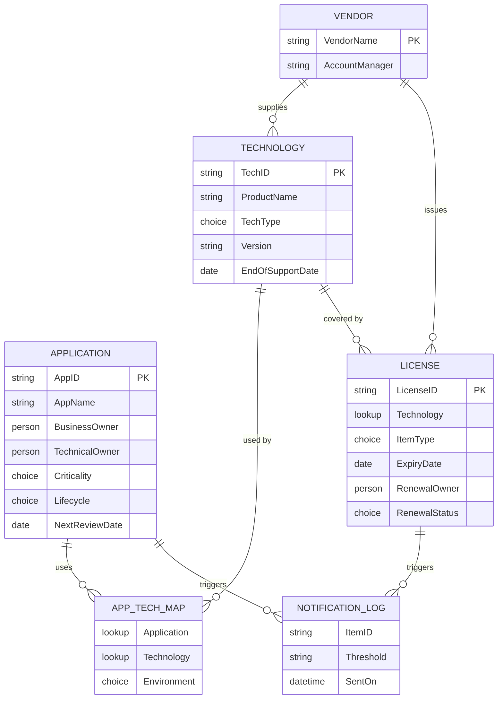
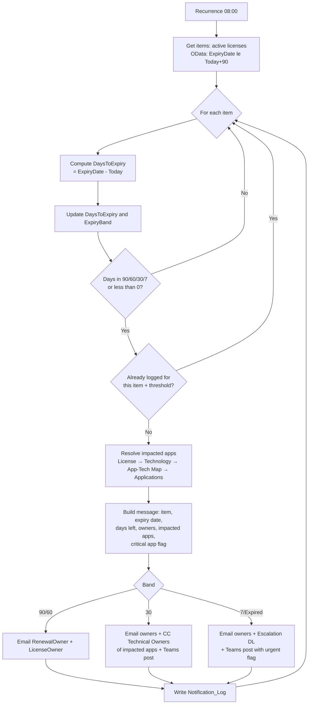

# SCBX Application & Technology Registry — Solution Design

| Item | Detail |
|---|---|
| Document | Solution Design — SCBX Application & Technology Registry (M365 option) |
| Version | 0.1 (Draft for review) |
| Date | 24 Nov 2026 |
| Author | THANAWAT MANOLAMAI — CCoE Migration |
| Reviewers | CCoE Lead, Security, M365/Power Platform Admin, Procurement |
| Status | Draft |

---

## 1. Purpose

This document describes a lightweight registry for SCBX internal applications, their technology components, and software licenses/contracts. It covers expiry tracking and notifications.

The solution uses **Microsoft Lists (SharePoint Online)**, **Power Automate**, and **Power BI**. This avoids deploying and operating a dedicated CMDB server, so there is no OS or middleware patching and no VA remediation for SCBX to own.

## 2. Scope

### 2.1 In scope

- Inventory of about 50 SCBX internal applications (SCBX Port scope only)
- Application ownership, criticality, lifecycle, hosting, and resilience attributes
- Technology components used by applications (software, platforms, SaaS)
- Licenses, subscriptions, support contracts, certificates, and other expirable items
- Many-to-many mapping between applications and technology/licenses
- Automated expiry notifications and annual application review reminders
- Management dashboard in Power BI

### 2.2 Out of scope

| Item | Owner / System |
|---|---|
| Incidents, service requests, SLA, support workflow | Jira Service Management (JSM) — SCBX Support team |
| Subsidiary applications and ITSM | Subsidiary ServiceNow instances |
| Automated discovery of infrastructure/cloud resources | Not in v1 (see §13 Future roadmap) |
| Procurement purchase orders and payments | Procurement / ERP |
| Cost optimization analysis | Not in scope |

### 2.3 Design principles

1. **Single source of truth.** Each record has exactly one master system. The registry stores references (IDs, URLs) to other systems instead of copying their data.
2. **Minimum viable metadata.** Keep mandatory fields to the minimum needed for governance.
3. **No infrastructure to operate.** Use only SaaS services that SCBX already has.
4. **Standard connectors only** in v1, to stay within Microsoft 365–included Power Platform rights. This must be confirmed against the SCBX agreement.
5. **Exit-ready.** Use stable IDs and a flat structure so the data can migrate to Dataverse or iTop later.

---

## 3. Assumptions & Constraints

| # | Assumption / Constraint |
|---|---|
| A1 | SCBX users have Microsoft 365 licenses that include SharePoint Online, Teams, Outlook, and Power Automate for standard connectors. |
| A2 | Power BI Pro (or equivalent) is available for the report author and viewers, or the report is published to a capacity-backed workspace. |
| A3 | Data volume is small (about 50 applications, fewer than 500 technology items, fewer than 500 licenses). |
| A4 | Registry data is classified as **Internal / Confidential** and contains no customer personal data. |
| A5 | Application owners are named Entra ID users. Group mailboxes are used for team ownership. |
| C1 | No premium connectors and no Dataverse in v1. |
| C2 | Flows run under a **service account**, not a personal account, so that they survive staff changes. |

---

## 4. Solution Architecture

### 4.1 Logical architecture



### 4.2 Component summary

| Component | Role | Notes |
|---|---|---|
| SharePoint Online site `SCBX-AppRegistry` | Hosts all lists. Acts as the security boundary. | Private site, not Teams-connected, or a dedicated private channel |
| Microsoft Lists | System of record | Version history enabled on all lists |
| Power Automate | Expiry notifications, review reminders, ID generation | Standard connectors only |
| Teams + Outlook | Notification channels | Adaptive card or post in a CCoE channel, plus email to owners |
| Power BI | Dashboards and governance KPIs | Import mode with scheduled refresh |
| JSM | Support tickets | Uses a `SCBX App ID` field (select list) that references the registry |

---

## 5. Data Model

### 5.1 Entity relationship



> **Design decision:** Licenses link to **Technology**, not directly to Applications. Application impact is derived through `App-Technology Map`. This avoids maintaining the same relationship in two places.
>
> **Exception:** application-specific contracts, such as a vendor maintenance contract for one application, use the optional `Related Application` lookup on the License list.

### 5.2 List: `Applications`

| Column (internal name) | Display name | Type | Req. | Values / Rule |
|---|---|---|:-:|---|
| `AppID` | App ID | Single line text (unique, indexed) | ✔ | `APP-###`, generated by flow or entered by admin |
| `Title` | Application Name | Single line text | ✔ | |
| `Description` | Description | Multiple lines (plain) | ✔ | 1–3 sentences on business purpose |
| `BusinessOwner` | Business Owner | Person | ✔ | |
| `TechnicalOwner` | Technical Owner | Person | ✔ | |
| `SupportGroup` | Support Group | Choice | ✔ | Matches the JSM team / queue |
| `OwningUnit` | Owning SCBX Unit | Lookup → `Ref_Units` | ✔ | |
| `Criticality` | Business Criticality | Choice | ✔ | Critical / High / Medium / Low |
| `Lifecycle` | Lifecycle Status | Choice | ✔ | Planned / In Development / Production / Retiring / Retired |
| `HostingModel` | Hosting Model | Choice | ✔ | Azure / AWS / GCP / On-Premises / SaaS / Hybrid |
| `CloudAccountRef` | Subscription / Account / Project | Single line text | | e.g. Azure subscription name or ID |
| `DataClassification` | Data Classification | Choice | ✔ | Per SCBX data classification standard |
| `InternetFacing` | Internet Facing | Yes/No | ✔ | |
| `RTO` | RTO (hours) | Number | Critical/High | |
| `RPO` | RPO (hours) | Number | Critical/High | |
| `DRAvailable` | DR in Place | Choice | | Yes / No / Partial / N/A |
| `ConsumingEntities` | Consuming Entities | Choice (multi) | | SCBX, subsidiaries |
| `RepoURL` | Source Repository | Hyperlink | | |
| `DocURL` | Architecture Doc | Hyperlink | | Confluence / SharePoint |
| `GoLiveDate` | Go-Live Date | Date | | |
| `RetirementDate` | Planned Retirement | Date | Retiring | |
| `LastReviewDate` | Last Reviewed | Date | ✔ | Set when the owner confirms the record |
| `NextReviewDate` | Next Review Due | Date | ✔ | Default `LastReviewDate + 365` (set by flow) |
| `Completeness` | Record Completeness % | Number | | Calculated by flow (see §7.4) |
| `Remarks` | Remarks | Multiple lines | | |

### 5.3 List: `Technology`

| Column | Type | Req. | Values / Rule |
|---|---|:-:|---|
| `TechID` | Text (unique, indexed) | ✔ | `TEC-###` |
| `Title` (Product Name) | Text | ✔ | e.g. *Red Hat Enterprise Linux* |
| `Vendor` | Lookup → `Ref_Vendors` | ✔ | |
| `TechType` | Choice | ✔ | Operating System / Database / Middleware / Security / Monitoring / Network Appliance / SaaS / PaaS Service / Library-Framework / Other |
| `Version` | Text | | |
| `EndOfSupportDate` | Date | | Vendor end of support or extended support |
| `TechOwner` | Person / Group | ✔ | Platform or technology owner |
| `Standard` | Choice | | Approved / Tolerated / Deprecated / Prohibited |
| `Remarks` | Multiple lines | | |

### 5.4 List: `Licenses & Contracts` (expirable items)

| Column | Type | Req. | Values / Rule |
|---|---|:-:|---|
| `LicenseID` | Text (unique, indexed) | ✔ | `LIC-###` |
| `Title` | Text | ✔ | Short name, e.g. *RHEL Subscription FY2027* |
| `ItemType` | Choice | ✔ | Software License / SaaS Subscription / Support & Maintenance / SSL-TLS Certificate / Domain / Hardware Warranty / Cloud Commitment / Other |
| `Technology` | Lookup → `Technology` | | Required except for Domain and Cloud Commitment |
| `RelatedApplication` | Lookup (multi) → `Applications` | | Only for application-specific contracts |
| `Vendor` | Lookup → `Ref_Vendors` | ✔ | |
| `LicenseModel` | Choice | | Perpetual / Subscription / Per-core / Per-user / Enterprise / Other |
| `Quantity` | Number | | |
| `StartDate` | Date | ✔ | |
| `ExpiryDate` | Date (indexed) | ✔ | Perpetual licenses: use the support end date |
| `NoticePeriodDays` | Number | ✔ | Default 90. Vendor cancellation or notice requirement |
| `AutoRenew` | Yes/No | ✔ | |
| `ContractRef` | Text | | PO / contract number |
| `ContractDoc` | Hyperlink | | Link to contract in a restricted procurement library |
| `AnnualCost` | Currency (THB) | | Restricted visibility (see §8.3) |
| `LicenseOwner` | Person | ✔ | Accountable owner |
| `RenewalOwner` | Person | ✔ | Executes the renewal |
| `RenewalStatus` | Choice | ✔ | Active / Renewal Planning / Renewal In Progress / Renewed / Will Not Renew / Expired |
| `DaysToExpiry` | Number | | Updated daily by flow. Calculated columns cannot use TODAY dynamically |
| `ExpiryBand` | Choice | | Healthy / ≤90 / ≤60 / ≤30 / ≤7 / Expired. Updated daily by flow |
| `RenewedBy` | Lookup → `Licenses & Contracts` | | Points to the successor record when renewed |
| `Remarks` | Multiple lines | | |

> **Renewal handling:** do not overwrite `ExpiryDate` on renewal. Create a new record for the new term, set the old record to `Renewed`, and link the two with `RenewedBy`. This keeps the contract history auditable.

### 5.5 List: `App-Technology Map`

| Column | Type | Req. | Notes |
|---|---|:-:|---|
| `Title` | Text | ✔ | Auto: `{AppID}-{TechID}` (prevents duplicates) |
| `Application` | Lookup → `Applications` (show `AppID`) | ✔ | |
| `Technology` | Lookup → `Technology` (show `TechID`) | ✔ | |
| `Environment` | Choice (multi) | | Prod / Non-Prod / DR |
| `UsageNote` | Text | | e.g. "Primary DB" |

### 5.6 Reference and support lists

| List | Purpose | Key columns |
|---|---|---|
| `Ref_Vendors` | Vendor master | Vendor Name, Account Manager, Support Contact, Remarks |
| `Ref_Units` | SCBX organization units | Unit Name, Unit Head |
| `Notification_Log` | Audit of sent notifications and duplicate prevention | ItemID, ItemType, Threshold, Recipients, SentOn, FlowRunID |
| `Config` | Thresholds and recipients without editing flows | Key, Value (e.g. `ExpiryThresholds = 90,60,30,7`, `EscalationDL`) |

### 5.7 ID and naming conventions

| Object | Format | Example |
|---|---|---|
| Application | `APP-###` | APP-001 |
| Technology | `TEC-###` | TEC-014 |
| License / Contract | `LIC-###` | LIC-027 |
| Map entry | `{AppID}-{TechID}` | APP-001-TEC-014 |

IDs are **never reused**. Retired records keep their ID and are filtered out by views.

---

## 6. User Experience

### 6.1 Views

| List | View | Filter / Purpose |
|---|---|---|
| Applications | **All Active** (default) | `Lifecycle ≠ Retired` |
| Applications | **My Applications** | `BusinessOwner = [Me] OR TechnicalOwner = [Me]` |
| Applications | **Review Overdue** | `NextReviewDate < [Today]` |
| Applications | **Critical without DR/RTO** | `Criticality = Critical AND (DRAvailable ≠ Yes OR RTO empty)` |
| Licenses | **Expiring ≤ 90 days** (default) | `ExpiryDate ≤ [Today]+90 AND RenewalStatus not in (Renewed, Will Not Renew)` |
| Licenses | **My Renewals** | `RenewalOwner = [Me] OR LicenseOwner = [Me]` |
| Licenses | **Expired** | `ExpiryBand = Expired` |
| Licenses | **Calendar** | Calendar view on `ExpiryDate` |
| Technology | **End of Support ≤ 12 months** | `EndOfSupportDate ≤ [Today]+365` |

### 6.2 Formatting

- Apply JSON column formatting to `ExpiryBand` and `Criticality` (red / amber / yellow / green).
- Configure list forms to show or hide conditional fields. For example, show `RTO`/`RPO` only when Criticality is Critical or High, and show `RetirementDate` only when Lifecycle is Retiring.

### 6.3 Entry points

- Pin the site to the CCoE Teams channel as a tab (Lists and Power BI).
- Link from JSM portal or Confluence: "Application not listed? Contact CCoE Registry Admin."

---

## 7. Automation (Power Automate)

All flows:
- Are owned by service account `svc-appregistry@…`, with a CCoE admin as co-owner
- Run in time zone **(UTC+07:00) Bangkok**
- Live in a Power Platform solution where the environment allows it, for portability and ALM
- Send failure alerts to the CCoE Registry Alerts channel

### 7.1 Flow F1 — Daily Expiry Evaluation & Notification

| Attribute | Value |
|---|---|
| Trigger | Recurrence — daily at 08:00 (UTC+7) |
| Source | `Licenses & Contracts` where `RenewalStatus` not in (Renewed, Will Not Renew) |
| Thresholds | 90 / 60 / 30 / 7 days, and expired (read from `Config`) |

**Logic**



**Key implementation notes**

- **Band rule:** notify when `DaysToExpiry` first falls at or below a threshold. Check the log instead of testing exact equality, so a missed run does not skip a notification.
- **Expired items:** after expiry, repeat the notification weekly (every Monday) until the status changes.
- Set `RenewalStatus` automatically to `Renewal Planning` at 90 days if it is still `Active`.
- **Expression examples:**
  - Days to expiry: `div(sub(ticks(item()?['ExpiryDate']), ticks(startOfDay(convertFromUtc(utcNow(),'SE Asia Standard Time')))), 864000000000)`
  - OData filter: `ExpiryDate le '@{addDays(utcNow(),90,'yyyy-MM-dd')}'`

A second pass (or a separate filter) refreshes `DaysToExpiry` and `ExpiryBand` for **all** active items, so that list views and Power BI stay accurate.

### 7.2 Flow F2 — Annual Application Review Reminder

| Attribute | Value |
|---|---|
| Trigger | Recurrence — weekly, Monday 09:00 |
| Logic | Applications where `NextReviewDate ≤ Today + 30` and `Lifecycle ≠ Retired` |
| Action | Email Business and Technical Owner a summary of the record with a **"Confirm record"** link (list item edit form) |
| Escalation | If overdue by more than 30 days, CC the Owning Unit Head and add to the weekly CCoE digest |

### 7.3 Flow F3 — On Review Confirmation

| Attribute | Value |
|---|---|
| Trigger | When an item is modified (Applications) and `LastReviewDate` changed |
| Action | Set `NextReviewDate = LastReviewDate + 365` |

### 7.4 Flow F4 — Record Completeness & ID Assignment

| Attribute | Value |
|---|---|
| Trigger | When an item is created or modified (Applications, Technology, Licenses) |
| Actions | (1) Assign the next ID if blank, using a counter in `Config`. (2) Calculate `Completeness` % of mandatory fields. (3) Build the `Title` key on the map list |
| Guard | Use a trigger condition so the flow does not re-trigger on its own updates (check the modifier is not the service account) |

### 7.5 Flow F5 — Weekly CCoE Digest

Every Monday 09:30, post one Teams message to the CCoE channel with:
- Licenses expiring in 30 / 90 days
- Expired items
- Reviews overdue
- Records below 80% completeness

### 7.6 Notification content template

> **[SCBX App Registry] License expiring in 37 days — LIC-023 SQL Server Enterprise**
>
> | | |
> |---|---|
> | Expiry date | 31 Dec 2026 |
> | Renewal owner | *Name* |
> | Vendor | Microsoft |
> | Impacted applications | APP-002, APP-017 (**Critical**), APP-031 |
> | Current status | Renewal Planning |
>
> Action: update **Renewal Status** in the registry once renewal is in progress. *(link to item)*

---

## 8. Security & Access Control

### 8.1 Roles

| Role | Members | Access |
|---|---|---|
| Registry Admin | CCoE (2–3 named people) | Full Control on site |
| Contributors | Application owners, technology owners, renewal owners | Edit on Applications, Technology, Map, Licenses |
| Readers | Management, architects, support team | Read on site + Power BI viewer |
| Procurement / Finance | Named group | Edit on Licenses (cost fields) |
| Service account | `svc-appregistry` | Edit (flows) |

Use **Entra ID security groups**, not individual users, for all permission assignments.

### 8.2 Controls

- Private SharePoint site. Disable external sharing.
- Apply the SCBX sensitivity label (e.g. *Confidential – Internal*) to the site.
- Enable **versioning** on all lists (keep at least 50 major versions) to provide an audit trail of changes.
- Record deletion is limited to Registry Admins. Contributors retire records instead (Lifecycle = Retired).
- Microsoft Purview audit log covers access and changes (tenant-level capability).
- Do **not** store secrets, license keys, or credentials in the registry. Store only a reference to where they are held (e.g. Key Vault / vendor portal).

### 8.3 Sensitive fields

SharePoint Lists do not support column-level security. If `AnnualCost` and contract documents must be restricted:

- **Option A (recommended):** move cost into a separate list `License_Financials`, linked by LicenseID, with access for Procurement/Finance and CCoE Admin only.
- **Option B:** keep cost out of the registry and link to the procurement system.

---

## 9. Reporting (Power BI)

### 9.1 Dataset

| Item | Design |
|---|---|
| Connector | SharePoint Online List (2.0 implementation) |
| Mode | Import |
| Refresh | Daily 09:00 (after F1 completes) |
| Workspace | `CCoE – App Registry` (dedicated workspace with Entra ID group access) |
| Credentials | Service account (OAuth) |

**Model:** star schema with `Applications`, `Technology`, `Licenses`, `Vendors`, and `Units` as dimensions, `App-Technology Map` as a bridge table, and a `Date` table related to `ExpiryDate`.

### 9.2 Key measures (DAX)

```DAX
Active Apps = CALCULATE(COUNTROWS(Applications), Applications[Lifecycle] <> "Retired")

Critical Apps = CALCULATE([Active Apps], Applications[Criticality] = "Critical")

Days To Expiry = DATEDIFF(TODAY(), SELECTEDVALUE(Licenses[ExpiryDate]), DAY)

Expiring 30d =
CALCULATE(
    COUNTROWS(Licenses),
    Licenses[ExpiryDate] >= TODAY(),
    Licenses[ExpiryDate] <= TODAY() + 30,
    NOT Licenses[RenewalStatus] IN {"Renewed", "Will Not Renew"}
)

Expired Items =
CALCULATE(
    COUNTROWS(Licenses),
    Licenses[ExpiryDate] < TODAY(),
    NOT Licenses[RenewalStatus] IN {"Renewed", "Will Not Renew"}
)

Reviews Overdue =
CALCULATE([Active Apps], Applications[NextReviewDate] < TODAY())

Avg Completeness = AVERAGE(Applications[Completeness])
```

### 9.3 Report pages

| Page | Content |
|---|---|
| **1. Portfolio Overview** | KPI cards (active apps, critical, retiring), apps by hosting model, lifecycle, owning unit, criticality |
| **2. License & Expiry** | Expiry band KPIs, timeline of the next 12 months, table of items with impacted apps, filter by vendor and type |
| **3. Impact Analysis** | Select a license/technology → impacted applications and owners (via bridge table) |
| **4. Governance Health** | Reviews overdue, completeness by owner, critical apps without DR/RTO/RPO, technology near end of support |
| **5. Application Detail** | Drill-through: one application with all technologies, licenses, owners, and links |

---

## 10. Integration with Jira Service Management

| Integration | v1 approach | Later option |
|---|---|---|
| Application reference on tickets | JSM custom field **SCBX App ID** (select list) maintained manually from the registry (about 50 values, low change rate) | Scheduled sync via JSM REST API (requires a premium HTTP connector or an Atlassian Automation pull) |
| Link from ticket to app record | Registry item URL in the field description or a Confluence lookup page | JSM Assets, if licensed |
| Ticket metrics per app | Not in v1 | Power BI joins a JSM export on App ID |

**Rule:** the registry never stores tickets, and JSM never stores application metadata beyond the App ID.

---

## 11. Non-Functional Requirements

| Category | Requirement | How it is met |
|---|---|---|
| Availability | Business hours. Short outage tolerated | Microsoft 365 SaaS SLA |
| Capacity | Fewer than 1,000 items per list | Well below list view thresholds. Index `AppID`, `TechID`, `LicenseID`, `ExpiryDate` |
| Lookup limits | Views must stay below the SharePoint lookup-column threshold | Limit lookups per view. Use the map list instead of many lookup columns |
| Backup / Recovery | Recover from accidental deletion or corruption | Recycle bin + version history + **monthly CSV/Excel export** to a restricted library (flow or manual) |
| Auditability | Who changed what, when | List versioning + Purview audit + Notification_Log |
| Maintainability | No custom code to patch | Configuration-only. Thresholds kept in the `Config` list |
| Portability | Exit to Dataverse/iTop | Stable IDs, flat lists, CSV export |
| Language | EN (Thai allowed in free text) | |

---

## 12. Operating Model

### 12.1 RACI

| Activity | CCoE Registry Admin | App Business Owner | App Technical Owner | License / Renewal Owner | Procurement | M365 Admin |
|---|:-:|:-:|:-:|:-:|:-:|:-:|
| Register new application | A | C | R | | | |
| Maintain application record | C | A | R | | | |
| Annual review confirmation | I | A | R | | | |
| Maintain technology record | A/R | | C | | | |
| Maintain license/contract record | C | | | A/R | C | |
| Act on expiry notification | I | I | C | A/R | R | |
| Retire application | A | R | R | | | |
| Flow and report maintenance | A/R | | | | | C |
| Access management | A/R | | | | | C |
| Quarterly data quality review | A/R | I | I | I | | |

### 12.2 Governance cadence

| Cadence | Activity |
|---|---|
| Daily | F1 expiry evaluation (automated) |
| Weekly | CCoE digest (automated) and review of open renewals |
| Monthly | Data export backup. Check flow run history |
| Quarterly | Data quality review (completeness below 80%, orphaned owners, stale records) |
| Annually | Full application review by owners. Review the design and decide whether to stay on Lists or move to Dataverse/iTop |

### 12.3 Joiner / Mover / Leaver

- Monthly check: owners who are disabled in Entra ID appear in a Power BI "Orphaned Owner" visual.
- Unit Head reassigns ownership within 2 weeks.

---

## 13. Future Roadmap and Exit Criteria

| Trigger | Next step |
|---|---|
| Items grow beyond ~2,000 per list, or relationships become complex (multi-level dependencies) | Migrate to **Dataverse + model-driven Power App** (premium licensing) |
| Need for CMDB capabilities (topology, impact graphs, discovery, CI lifecycle) | Re-evaluate **iTop** (self-hosted or SaaS) or **JSM Assets** |
| Need for automated cloud inventory | Pull from Azure Resource Graph / AWS Config / GCP Asset Inventory into Power BI or Dataverse |
| Application owners find Lists forms hard to use | Add a **Canvas Power App** over the existing Lists (no data migration) |

---

## 14. Implementation Plan (about 3 weeks)

| Week | Activities | Deliverables |
|---|---|---|
| **W1 — Build** | Create site and security groups. Create lists, columns, views, formatting. Create Config and Ref lists | Site and lists ready |
| **W1–2 — Data** | Clean the existing SCBX Port application list in Excel. Assign IDs. Import (Excel → list, or grid-view paste). Collect licenses from Procurement and owners | 50 apps loaded, initial licenses loaded |
| **W2 — Automate** | Build F1–F5. Configure the service account. Test notification content | Flows running in test mode (notifications to CCoE only) |
| **W2–3 — Report** | Build the Power BI dataset and 5 pages. Configure refresh | Report published |
| **W3 — Validate** | UAT with 5–10 owners. Security review. Go-live communication | Sign-off, go-live |

### 14.1 Test cases (summary)

| # | Test | Expected result |
|---|---|---|
| T1 | License expiring in 89 days | 90-day notification sent once and logged. Status → Renewal Planning |
| T2 | Flow does not run for 2 days across the 60-day threshold | Notification still sent on the next run (band logic) |
| T3 | License with 3 mapped applications, 1 Critical | Message lists all 3 and flags the Critical one |
| T4 | Status set to Renewed | No further notifications |
| T5 | Expired item | Weekly repeat until the status changes |
| T6 | Owner confirms review | NextReviewDate = +365 days |
| T7 | Reader account attempts edit | Denied |
| T8 | Restore a deleted item from the recycle bin | Item and version history restored |
| T9 | Power BI refresh | Matches list counts. Days-to-expiry is correct in UTC+7 |

---

## 15. Risks & Mitigations

| Risk | Impact | Mitigation |
|---|---|---|
| Data becomes stale | Registry loses trust | Annual review flow, completeness KPI, quarterly CCoE review |
| Flow owner leaves | Notifications stop | Service account ownership plus a co-owner. Failure alerts |
| Notification fatigue | Owners ignore emails | Fixed thresholds only, deduplicated via log, weekly digest instead of daily |
| Cost or contract data exposed | Confidentiality breach | Separate restricted financials list. Sensitivity label |
| Scope creep toward a full CMDB | Lists become unmanageable | Exit criteria in §13. Change control through CCoE |
| Licensing assumption incorrect | Unplanned cost | Confirm M365 / Power BI entitlements before build (Open item O1) |

---

## 16. Open Items / Decisions Required

| # | Item | Owner | Due |
|---|---|---|---|
| O1 | Confirm Power Automate (standard connectors) and Power BI Pro entitlements for builders and viewers | M365 Admin | |
| O2 | Provision service account `svc-appregistry` (licensed mailbox, MFA exception policy per SCBX standard) | IAM | |
| O3 | Confirm data classification of the registry and the sensitivity label | Security | |
| O4 | Decide whether cost data is stored (Option A or B, §8.3) | CCoE Lead / Procurement | |
| O5 | Confirm the source and owner of the initial license data | Procurement | |
| O6 | Agree on criticality definitions (align with SCBX BIA / IT risk standard) | CCoE / Risk | |
| O7 | Confirm the JSM App ID field approach with the Support team | Support Lead | |

---

## Appendix A — Initial Data Collection Template (Excel)

Collect data in this format, then import it into Lists.

**Sheet `Applications`:** `AppID | ApplicationName | Description | BusinessOwnerEmail | TechnicalOwnerEmail | SupportGroup | OwningUnit | Criticality | Lifecycle | HostingModel | CloudAccountRef | DataClassification | InternetFacing | RTO | RPO | DRAvailable`

**Sheet `Technology`:** `TechID | ProductName | Vendor | TechType | Version | EndOfSupportDate | TechOwnerEmail`

**Sheet `Licenses`:** `LicenseID | Title | ItemType | TechID | Vendor | LicenseModel | Quantity | StartDate | ExpiryDate | NoticePeriodDays | AutoRenew | ContractRef | LicenseOwnerEmail | RenewalOwnerEmail | RenewalStatus`

**Sheet `AppTechMap`:** `AppID | TechID | Environment | UsageNote`

Use data validation drop-downs matching the list choice values. Dates use the `yyyy-mm-dd` format.

## Appendix B — Choice Values Master

| Field | Values |
|---|---|
| Criticality | Critical, High, Medium, Low |
| Lifecycle | Planned, In Development, Production, Retiring, Retired |
| HostingModel | Azure, AWS, GCP, On-Premises, SaaS, Hybrid |
| ItemType | Software License, SaaS Subscription, Support & Maintenance, SSL-TLS Certificate, Domain, Hardware Warranty, Cloud Commitment, Other |
| RenewalStatus | Active, Renewal Planning, Renewal In Progress, Renewed, Will Not Renew, Expired |
| ExpiryBand | Healthy, ≤90, ≤60, ≤30, ≤7, Expired |
| Standard | Approved, Tolerated, Deprecated, Prohibited |
